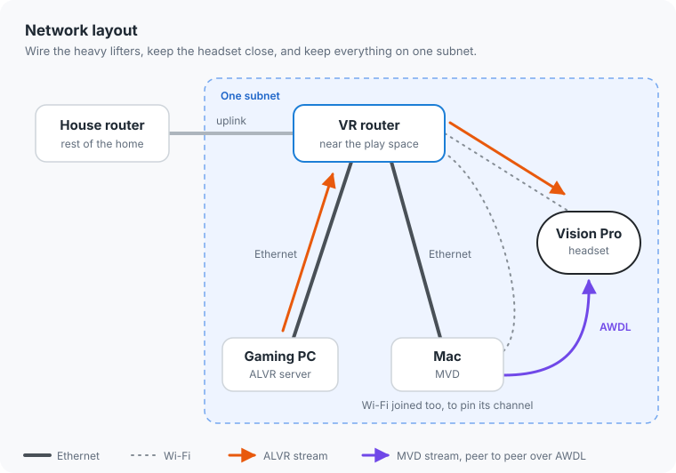
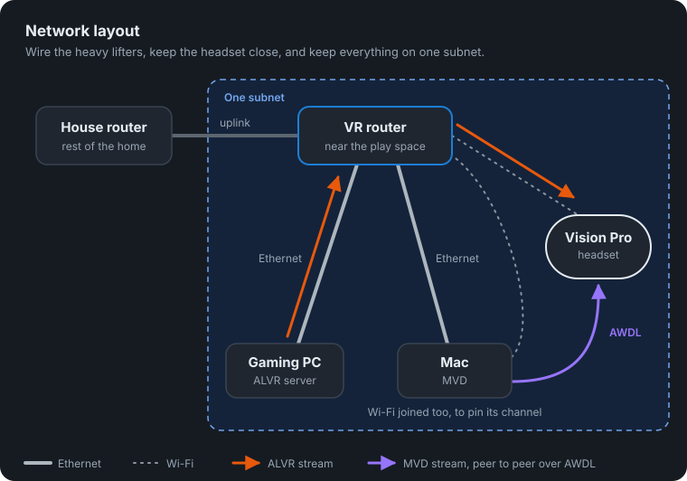
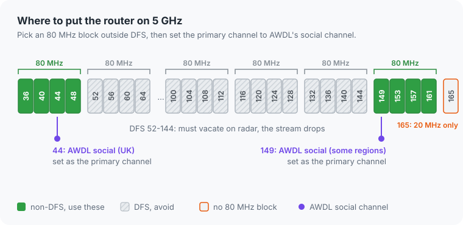
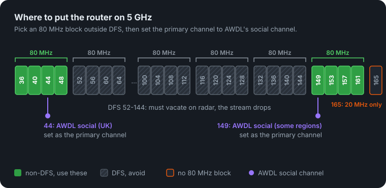
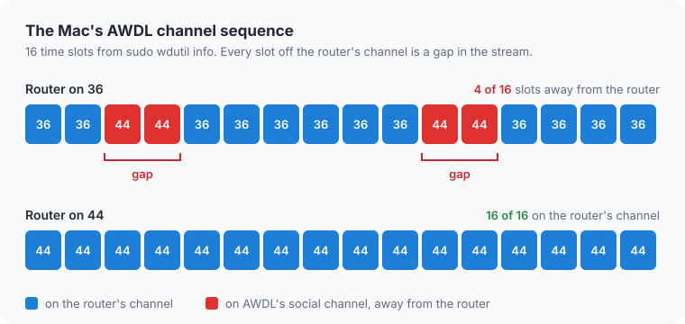
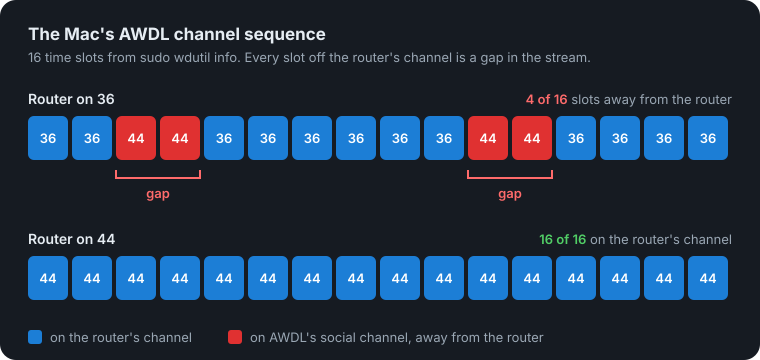

Running Mac Virtual Display (MVD) and ALVR on my Apple Vision Pro at the same time made ALVR stutter. Even on a clean 5 GHz channel with no neighbours on it.

My setup: I play Elite Dangerous in VR. The game runs on a Windows PC and streams to the headset over ALVR, while my Mac sits beside the game in MVD with my tools. That's two wireless streams landing on one headset.

The fix: put the router on a non-DFS 80 MHz block, with its primary channel on AWDL's social channel (44 in the UK). Then the Apple devices stop hopping between the router's channel and AWDL's, and the stutter goes away.

If you just want your setup fixed, I turned all of this into an agent skill, [avp-mvd-alvr-stutter-resolver](https://github.com/TheClooneyCollection/skills/tree/main/skills/avp-mvd-alvr-stutter-resolver). Point your agent at it and it will audit and fix your setup. If you're interested in the details, read on.

<figure style="text-align: center;">
  
  <figcaption>The goal: the game in front of me and my Mac tools beside the cockpit, both streaming to the headset at once.</figcaption>
</figure>

[[toc]]

## Best practices

Here's the setup I've settled on. None of it is exotic, but each piece is there for a reason, and the last one is the piece that actually fixed the stutter.

### Network layout

Give the play space its own router. If you already have a main house router, keep it, and put a second, dedicated one near where you play. That keeps the VR traffic away from everything else in the house and puts the headset close to its access point.

<figure style="text-align: center;">
  
  <figcaption>The VR router sits beside the play space, wired to the PC and the Mac, with a clear line of sight to the headset.</figcaption>
</figure>

Wire both the gaming PC and the Mac to that router. The two machines doing the heavy lifting shouldn't be competing with the headset for airtime. On the Mac, keep Ethernet first in the network service order, so its traffic takes the cable.

Then join the Vision Pro *and* the Mac's Wi-Fi to the same router. This one sounds odd, since the Mac is already wired. Its Wi-Fi isn't there for traffic. It's there to pin the Mac's radio to the same channel as the headset.

Finally, keep the PC, the Mac and the Vision Pro on one subnet. ALVR discovery (and mDNS) doesn't cross routers, so if the headset sits behind a different router from the PC, ALVR simply won't find it.

<figure style="text-align: center;">
  
  
  <figcaption>Two streams, one headset: ALVR goes through the VR router, MVD goes straight from the Mac over AWDL.</figcaption>
</figure>

### Router settings

Use 5 GHz at 80 MHz width. 160 MHz looks tempting, but it overlaps more neighbours and more DFS channels, and ALVR fits comfortably in 80.

Pick a non-DFS block: 36-48 or 149-161. DFS channels (52-144) have to vacate when the router detects radar, and when that happens your stream drops mid-flight.

Lock the channel rather than leaving it on auto. Auto can wander onto a DFS channel later, and you're back to random drops.

For the wireless mode, keep the mixed mode that includes 802.11ax. Dropping the legacy modes buys very little, and a mode without ax can lock the Vision Pro out entirely.

And ignore the "best channel" picks from Wi-Fi scanner apps, such as 165. Channel 165 is 20 MHz only, so it can't give you an 80 MHz block.

<figure style="text-align: center;">
  
  
  <figcaption>The 5 GHz band: pick a non-DFS 80 MHz block, and put the primary channel on AWDL's social channel.</figcaption>
</figure>

### The channel that matters

Inside your non-DFS block, set the router's primary channel to AWDL's social channel: 44 in the UK, and 149 in some other regions. This is the setting that made the stutter go away for me, and the next section explains why.

### Checklist

| Setting | Recommendation |
|---|---|
| Router | Dedicated, near the play space |
| PC and Mac | Wired; Ethernet first on the Mac |
| Vision Pro and Mac Wi-Fi | Joined to the same router |
| Subnet | PC, Mac and Vision Pro on one subnet |
| Band and width | 5 GHz, 80 MHz |
| Channel block | Non-DFS: 36-48 or 149-161 |
| Primary channel | AWDL's social channel (44 in the UK, 149 in some other regions) |
| Channel selection | Locked, not auto |
| Wireless mode | Mixed mode including 802.11ax |

## Why a clean channel wasn't enough

Apple devices run AWDL (Apple Wireless Direct Link) for AirDrop, Continuity and MVD's peer-to-peer link (`llw0` on the Mac, low-latency Wi-Fi). AWDL keeps a "social" channel: 6 on 2.4 GHz, and 44 or 149 on 5 GHz depending on region.

Each Apple device has one Wi-Fi radio. If the router's channel is different from AWDL's, the radio time-slices between the two. Every slot it spends away from the router's channel is a gap in the stream. That's the stutter.

<figure style="text-align: center;">
  
  
  <figcaption>Before: the radio splits its time between the router's channel and AWDL's. After: one channel, no gaps.</figcaption>
</figure>

So the channel being clean wasn't the problem. The channel being *different* was.

<figure style="text-align: center;">
  
  <figcaption>Hopping between two channels breaks the stream up. Staying on one keeps it smooth.</figcaption>
</figure>

## Seeing it on macOS

You don't have to take this on faith. On the Mac, you can watch the hopping happen.

Without sudo, you can see the Mac's current channel:

```sh
system_profiler SPAirPortDataType | grep -A3 "Current Network Information"
```

With sudo, you get much more. Run this in a real terminal, since coding agents usually can't type a sudo password:

```sh
sudo wdutil info
```

Here's the Mac's AWDL section with my router on channel 36:

```
Channel Sequence : 36++ 36++ 44++ 44++ 36++ 36++ 36++ 36++ 36++ 36++ 44++ 44++ 36++ 36++ 36++ 36++
Sync State       : Master
```

The Mac's AWDL schedule spent 4 of every 16 slots on channel 44 while the router was on 36. That's the Mac's radio leaving the router's channel a quarter of the time. (`Sync State: Master` just means the Mac was the AWDL election master, keeping the timing. It doesn't mean the Mac picks the channels.)

After moving the router's primary channel to 44 (same 80 MHz block, 36-48, still non-DFS):

```
Channel Sequence : 44++ 44++ 44++ 44++ 44++ 44++ 44++ 44++ 44++ 44++ 44++ 44++ 44++ 44++ 44++ 44++
```

The Mac's AWDL schedule is all 44 now, so its radio no longer leaves the router's channel.

The Vision Pro uses the same AWDL social channel, so it should benefit the same way. I couldn't measure that on the headset directly, since visionOS has no `wdutil`. But the ALVR retest is the real check, and it passed: no more stuttering.

The same `wdutil info` output also shows CCA (how busy the channel is, in percent), RSSI and noise for the router link, which is handy for checking the rest of the setup.

## Other ALVR checks

If the network looks right and you still see trouble, two more things are worth checking.

On an NVIDIA PC, Parsec and ALVR share the NVENC encoder. Close Parsec while you're in VR. To see how busy the encoder is, watch the `enc` column of `nvidia-smi dmon -s u`.

On the Mac, MVD traffic runs on `llw0`, not `awdl0`. `netstat -I llw0 -b` shows its byte counters, so you can see how much MVD is actually sending. For me it's normally roughly 11-16 Mbps.

## Back in the cockpit

I retested ALVR with the router's primary channel on 44. No more stuttering.

<figure style="text-align: center;">
  
  <figcaption>The goal: the game in front of me and my Mac tools beside the cockpit, both streaming to the headset at once.</figcaption>
</figure>

ALVR's stats during the test said the network was healthy:

- **Transport latency:** 5.91 ms
- **Packets lost:** 0
- **Decode latency on the Vision Pro:** 2.35 ms

Network and decode together come to about 8 ms.

Now I can fly a long haul in Elite Dangerous with my Mac tools open beside the cockpit, and the only thing jumping is the frame shift drive.

If your Vision Pro stutters with MVD and ALVR running together, check one thing first: is your router's primary channel on AWDL's social channel (44 in the UK, 149 in some regions)? Or point your agent at [avp-mvd-alvr-stutter-resolver](https://github.com/TheClooneyCollection/skills/tree/main/skills/avp-mvd-alvr-stutter-resolver) and let it check the rest.
