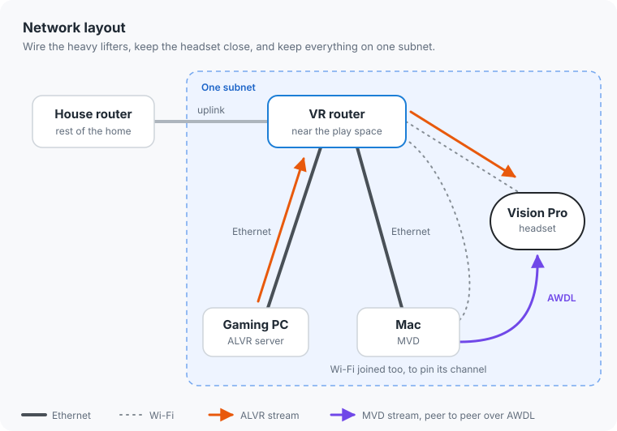
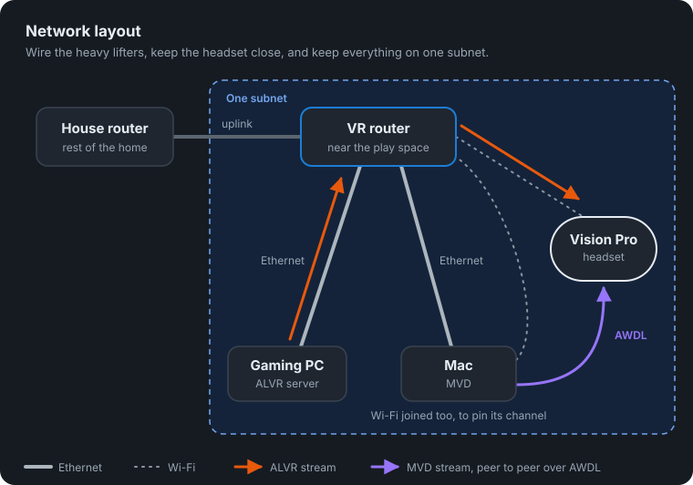
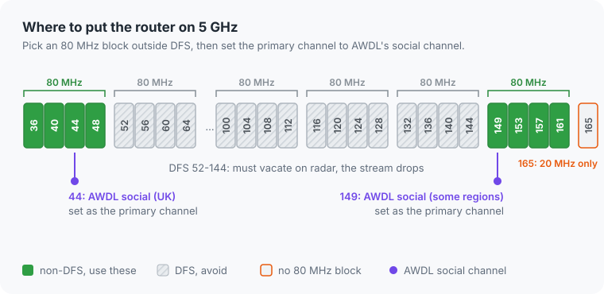
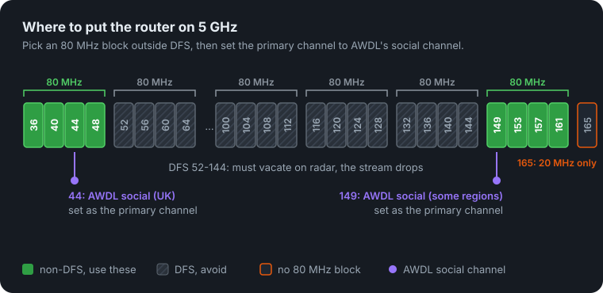
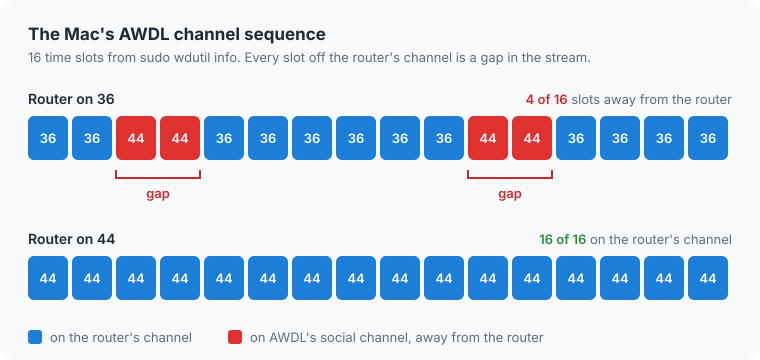
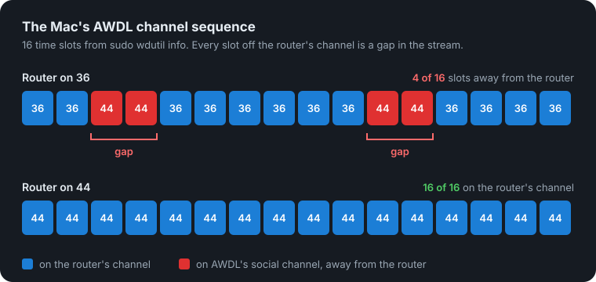

在我的 Apple Vision Pro 上同时运行 Mac Virtual Display（MVD）和 ALVR，会让 ALVR 卡顿。即使选了一个干净、没有邻居占用的 5 GHz 信道，也一样。

我的配置是这样的：我用 VR 玩 Elite Dangerous。游戏在 Windows PC 上运行，通过 ALVR 串流到头显；与此同时，我的 Mac 通过 MVD 显示在游戏旁边，上面开着我的工具。也就是说，两路无线串流同时传到一个头显上。

解决办法：把路由器设在一个非 DFS 的 80 MHz 信道块上，并将主信道设为 AWDL 的社交信道（英国是 44）。这样，Apple 设备就不用在路由器和 AWDL 的信道之间来回跳转，卡顿也就消失了。

如果你只想把自己的配置调好，我已经把这些整理成了一个 agent 技能：[avp-mvd-alvr-stutter-resolver](https://github.com/TheClooneyCollection/skills/tree/main/skills/avp-mvd-alvr-stutter-resolver)。把它交给你的 agent，它就会检查并修正你的配置。如果你想了解细节，就继续往下看。

<figure style="text-align: center;">
  
  <figcaption>目标：游戏在眼前，Mac 上的工具在座舱旁，两者同时串流到头显上。</figcaption>
</figure>

[[toc]]

## 最佳实践

这是我最后确定下来的配置。没有什么特别的，但每一项都有它的理由，最后那一项才是真正解决卡顿的关键。

### 网络布局

给游戏区域配一台专用路由器。如果家里已经有主路由器，就保留它，再把第二台专用路由器放在你玩游戏的位置附近。这样，VR 流量就不会和家里其他设备的流量挤在一起，头显离接入点也近。

<figure style="text-align: center;">
  
  <figcaption>VR 路由器放在游戏区域旁边，用网线连接 PC 和 Mac，与头显之间视线无遮挡。</figcaption>
</figure>

游戏 PC 和 Mac 都用网线连接这台路由器。这两台承担主要工作的机器，不该再和头显争用无线传输时间。在 Mac 上，把 Ethernet 放在网络服务顺序的首位，让它的流量走网线。

然后，让 Vision Pro *和* Mac 的 Wi-Fi 都连接到同一台路由器。这听起来有点奇怪，因为 Mac 已经接了网线。这里开 Wi-Fi 不是为了传流量，而是为了让 Mac 的无线电保持在和头显相同的信道上。

最后，确保 PC、Mac 和 Vision Pro 在同一个子网。ALVR 的设备发现（以及 mDNS）不会跨越路由器，所以如果头显和 PC 分别在不同路由器后面，ALVR 就找不到头显。

<figure style="text-align: center;">
  
  
  <figcaption>两路串流，一个头显：ALVR 走 VR 路由器，MVD 从 Mac 经 AWDL 直接传到头显。</figcaption>
</figure>

### 路由器设置

使用 5 GHz，信道宽度设为 80 MHz。160 MHz 看起来很诱人，但它会与更多邻居的信道以及更多 DFS 信道重叠，而 80 MHz 对 ALVR 来说已经很充裕了。

选择非 DFS 信道块：36-48 或 149-161。使用 DFS 信道（52-144）时，路由器一旦检测到雷达，就必须让出信道。这时，你还在飞行途中，串流就断了。

固定信道，不要留在自动模式。自动选择可能过一阵子又跑到 DFS 信道上，那就又会随机断流。

无线模式保留包含 802.11ax 的混合模式。去掉旧模式没多少收益，而不含 ax 的模式可能会让 Vision Pro 完全连不上。

也别理 Wi-Fi 扫描应用推荐的那些“最佳信道”，比如 165。信道 165 只支持 20 MHz，给不了你一个 80 MHz 信道块。

<figure style="text-align: center;">
  
  
  <figcaption>5 GHz 频段：选一个非 DFS 的 80 MHz 信道块，再把主信道设为 AWDL 的社交信道。</figcaption>
</figure>

### 真正关键的信道

在你选定的非 DFS 信道块内，把路由器的主信道设为 AWDL 的社交信道：英国是 44，部分其他地区是 149。正是这个设置解决了我的卡顿，下一节会解释原因。

### 检查清单

| 设置 | 建议 |
|---|---|
| 路由器 | 专用，靠近游戏区域 |
| PC 和 Mac | 有线连接；Mac 上优先使用 Ethernet |
| Vision Pro 和 Mac Wi-Fi | 连接同一台路由器 |
| 子网 | PC、Mac 和 Vision Pro 在同一个子网 |
| 频段和宽度 | 5 GHz，80 MHz |
| 信道块 | 非 DFS：36-48 或 149-161 |
| 主信道 | AWDL 的社交信道（英国是 44，部分其他地区是 149） |
| 信道选择 | 固定，不用自动 |
| 无线模式 | 包含 802.11ax 的混合模式 |

## 为什么信道干净还不够

Apple 设备通过 AWDL（Apple Wireless Direct Link）支持 AirDrop、Continuity，以及 MVD 的点对点连接（Mac 上的 `llw0`，低延迟 Wi-Fi）。AWDL 有一个“社交”信道：在 2.4 GHz 上是 6，在 5 GHz 上则根据地区使用 44 或 149。

每台 Apple 设备只有一个 Wi-Fi 无线电。如果路由器的信道和 AWDL 不同，无线电就会以时间片的方式在两者之间切换。每离开路由器信道一个时隙，串流就会出现一段空缺。这就是卡顿。

<figure style="text-align: center;">
  
  
  <figcaption>调整前：无线电把时间分给路由器信道和 AWDL 信道。调整后：只有一个信道，没有空缺。</figcaption>
</figure>

所以，问题不在于信道不干净，而在于两个信道*不一样*。

<figure style="text-align: center;">
  
  <figcaption>在两个信道之间跳转，串流就会断断续续。停留在一个信道上，就能保持流畅。</figcaption>
</figure>

## 在 macOS 上观察

不用只听我这么说。在 Mac 上，你可以直接看到信道跳转。

不需要 sudo，就能查看 Mac 当前的信道：

```sh
system_profiler SPAirPortDataType | grep -A3 "Current Network Information"
```

有 sudo 权限，能看到的信息就多得多。请在真正的终端里运行下面这条命令，因为编程 agent 通常没法输入 sudo 密码：

```sh
sudo wdutil info
```

路由器设在信道 36 时，我的 Mac 的 AWDL 部分是这样的：

```
Channel Sequence : 36++ 36++ 44++ 44++ 36++ 36++ 36++ 36++ 36++ 36++ 44++ 44++ 36++ 36++ 36++ 36++
Sync State       : Master
```

路由器在 36，而 Mac 的 AWDL 调度每 16 个时隙中有 4 个在信道 44。也就是说，Mac 的无线电有四分之一的时间离开了路由器信道。（`Sync State: Master` 只表示 Mac 被选为 AWDL 的主节点，负责维持时序，不代表由 Mac 决定使用哪些信道。）

把路由器的主信道改为 44 之后（仍然是同一个 80 MHz 信道块，36-48，仍然是非 DFS）：

```
Channel Sequence : 44++ 44++ 44++ 44++ 44++ 44++ 44++ 44++ 44++ 44++ 44++ 44++ 44++ 44++ 44++ 44++
```

现在 Mac 的 AWDL 调度全是 44，它的无线电不再离开路由器信道了。

Vision Pro 使用相同的 AWDL 社交信道，所以应该也能以同样的方式受益。我没法直接在头显上测量这一点，因为 visionOS 没有 `wdutil`。不过，重新测试 ALVR 才是真正的检验，而结果通过了：不再卡顿。

同一份 `wdutil info` 输出还会显示路由器连接的 CCA（信道繁忙程度，以百分比表示）、RSSI 和噪声，检查其余配置时很方便。

## 其他 ALVR 检查

如果网络看起来没问题，却还是不顺畅，还有两件事值得检查。

在配备 NVIDIA 显卡的 PC 上，Parsec 和 ALVR 共用 NVENC 编码器。使用 VR 时，关掉 Parsec。要看编码器有多忙，可以观察 `enc` 列，运行 `nvidia-smi dmon -s u` 就能看到。

在 Mac 上，MVD 流量走的是 `llw0`，不是 `awdl0`。`netstat -I llw0 -b` 会显示它的字节计数器，让你看到 MVD 实际发送了多少数据。我这里通常大约是 11-16 Mbps。

## 回到座舱

把路由器主信道设为 44 后，我重新测试了 ALVR。不再卡顿了。

<figure style="text-align: center;">
  
  <figcaption>目标：游戏在眼前，Mac 上的工具在座舱旁，两者同时串流到头显上。</figcaption>
</figure>

测试期间，ALVR 的统计数据也说明网络状况良好：

- **传输延迟：** 5.91 ms
- **丢包数：** 0
- **Vision Pro 上的解码延迟：** 2.35 ms

网络和解码加起来，大约 8 ms。

现在，我可以在 Elite Dangerous 里跑长途货运，同时在座舱旁打开 Mac 上的工具。唯一还在跳跃的，就只有 frame shift drive 了。

如果你的 Vision Pro 在同时运行 MVD 和 ALVR 时卡顿，先检查一件事：路由器的主信道是不是 AWDL 的社交信道（英国是 44，部分地区是 149）？或者把 [avp-mvd-alvr-stutter-resolver](https://github.com/TheClooneyCollection/skills/tree/main/skills/avp-mvd-alvr-stutter-resolver) 交给你的 agent，让它把其余配置也检查一遍。
